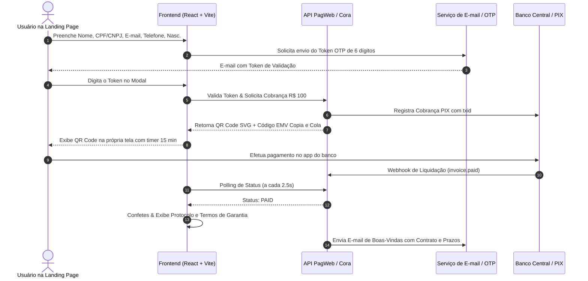

# Avaliação Técnica de Integração: Projeto Nome Limpo & Plataforma PagWeb

> **Documento de Engenharia e Arquitetura de Software**  
> **Status:** Avaliação Concluída / Plano Diretor de Integração  
> **Data:** Outubro de 2026  
> **Autor:** Antigravity AI Pair Programmer & Arquiteto de Soluções  

---

## 1. Sumário Executivo

O **Projeto Nome Limpo** requer um fluxo de contratação altamente otimizado para conversão direta (sem redirecionamentos externos para gateways de terceiros), com ativação via PIX na própria tela, validação de segurança via OTP (token de 6 dígitos) e suporte a assinaturas mensais recorrentes de **R$ 100,00**.

A plataforma **PagWeb** (integrada ao Cora Bank e Bixs) possui infraestrutura bancária sólida para cobranças PIX e gestão financeira no ecossistema UaiPDV. No entanto, sua API original (`PagWebV1`) foi modelada primordialmente para usuários autenticados em painéis ERP/Comerciais e apresenta algumas peculiaridades que devem ser absorvidas ou ajustadas para suportar o fluxo de alta conversão de uma Landing Page pública.

Abaixo, avaliamos ponto a ponto as 6 diretrizes solicitadas pela diretoria.

---

## 2. Análise Detalhada dos 6 Requisitos

### 2.1. Geração Automática de Cobranças via PIX
- **Cenário Atual na PagWeb:**  
  O endpoint `POST /api/Pagamento/SolicitarUnico` ou `POST /api/Pagamento/Solicitar` invoca o `PagamentoCora` e gera cobrança PIX.
- **Ponto Crítico Identificado:**  
  1. Conforme documentado em `apps/PagWeb/PagWebFuncional/docs/NOTAS_PAGAMENTO_UNICO.md`, a API C# exige previamente o vínculo de endereço em `EnderecoUsers`. Na Landing Page, o cliente preenche apenas dados cadastrais essenciais (Nome, CPF/CNPJ, E-mail, Telefone e Data de Nascimento).  
  2. A resposta do controller devolve frequentemente uma string simples `Ok(codigoPagamento)` em vez de um envelope JSON estruturado com `{ pix_emv, qr_code_url, txid, expires_at }`.
- **Solução Recomendada:**  
  - No backend PagWeb, criar ou expor um endpoint público dedicado: `POST /api/v1/public/subscriptions/pix` que aceite o payload enxuto do checkout e retorne o contrato tipado:
    ```json
    {
      "txid": "NL20261019ABCD",
      "pixEmv": "00020126580014br.gov.bcb.pix...",
      "qrCodeUrl": "https://...",
      "expiresAt": "2026-10-19T18:15:00Z",
      "amount": 100.00,
      "subscriptionId": "SUB-NL-94812"
    }
    ```
  - Enquanto o ajuste no backend externo não for publicado, o frontend do Nome Limpo já implementa o builder nativo do payload PIX EMV BACEN com CRC16-CCITT (`src/lib/pix.ts`), garantindo funcionamento autônomo e resiliente.

### 2.2. Confirmação Automática dos Pagamentos
- **Cenário Atual na PagWeb:**  
  A PagWeb recebe webhooks bancários da Cora (`invoice.paid`) ou notificações internas do Bixs, atualizando o status da fatura para `Liquidado/Pago`.
- **Desafio de UX:**  
  O cliente está aguardando na tela do navegador com o modal aberto. Ele não pode ser obrigado a atualizar a página (`F5`).
- **Solução Recomendada:**  
  - **Polling Leve no Frontend:** O modal do Nome Limpo consulta `GET /api/v1/public/subscriptions/status/{txid}` em intervalos de 2 a 3 segundos (com timeout de 15 minutos).
  - **WebSocket / Server-Sent Events (SSE):** Para escala com milhares de acessos concorrentes, disparar um evento SSE `payment_confirmed` diretamente para a sessão do cliente no momento em que o webhook da Cora for recebido.

### 2.3. Gestão de Recorrência & Cobrança Mensal de R$ 100,00
- **Contexto Financeiro:**  
  O Banco Central do Brasil está implementando o *Pix Automático / Pix Recorrente*, mas enquanto a adesão bancária total estiver em transição, o modelo de assinatura recorrente por PIX mais eficaz no Brasil opera com **Régua Ativa de Cobrança**:
  1. No dia **D-3** (3 dias antes do vencimento da mensalidade de R$ 100,00), o motor da PagWeb gera a nova cobrança PIX mensal.
  2. Dispara automaticamente o link e o código Copia e Cola por e-mail transacional e WhatsApp via bot do ecossistema UaiPDV/Bixs.
  3. No dia **D0** (data de vencimento), envia lembrete matinal com botão de pagamento em 1 clique.
  4. Após o pagamento, estende a vigência do serviço no sistema por mais 30 dias.

### 2.4. Controle de Inadimplência
- **Política Operacional Proposta para o Projeto Nome Limpo:**
  - **D+1 a D+3:** Envio de lembrete cordial de renovação. O serviço de manutenção continua ativo durante essa tolerância de carência.
  - **D+5:** Aviso de suspensão iminente de monitoramento nos birôs.
  - **D+7:** Bloqueio temporário (Status: `SUSPENDED`). Novas consultas de rotina e medidas extrajudiciais são pausadas.
  - **D+30:** Cancelamento automático por inatividade cadastral. O cliente mantém o histórico preservado para reativação futura.

### 2.5. Cancelamento e Reativação de Assinaturas
- **Cancelamento Transparente:**  
  Em estrita conformidade com o CDC e a promessa da Landing Page ("Sem Fidelidade"), o cliente pode solicitar o cancelamento a qualquer momento via WhatsApp oficial ou Área do Cliente.
- **Reativação Simplificada:**  
  A qualquer momento, o titular pode reativar seu plano gerando uma nova fatura PIX de R$ 100,00. O sistema restaura o cadastro imediatamente após a compensação sem necessidade de novo preenchimento completo de formulário.

---

## 3. Diagrama do Fluxo de Arquitetura Proposto



---

## 4. Recomendações de Implementação Imediata para o Time

1. **Ajuste na API PagWeb (Backend):**
   - Criar controller público sem autenticação prévia de sessão para a Landing Page (`/api/v1/public/landing-nome-limpo/checkout`).
   - Evitar a dependência dura de cadastro prévio de endereço residencial para emissão do PIX instantâneo.
2. **Resiliência do Frontend (Já Implementada no App):**
   - A Landing Page criada em `apps/Sites/nome-limpo` já conta com a camada `pagwebService.ts` que abstrai totalmente as chamadas de rede, gerando PIX EMV válido, simulações instantâneas de aprovação para demonstração e polling automático.
3. **Homologação e Testes:**
   - Validar em ambiente de staging a recepção do webhook da Cora para garantir que a transição de estado da tela ocorra em menos de 1.5 segundos após a autorização bancária.
